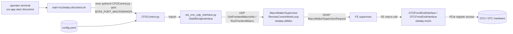

# mu2edaq-CFOControl

> Python command-line client for the otsdaq MacroMaker UDP remote-control
> interface that lists front-ends and their FE macros and runs one macro, such
> as CFO Write, on a CFO or DTC front-end

| | |
|---|---|
| Repository | `Mu2e/mu2edaq-CFOControl` (public) |
| Language | Python 3 (3.9-compatible syntax), PyYAML only |
| Ports | 5000/udp **outbound** (destination; the server port is set by `OTS_MACROMAKER_UDP_PORT` on the MacroMaker host) |
| Depends on | otsdaq MacroMaker supervisor (otsdaq-utilities, external); FE macros registered by `otsdaq-mu2e` |
| Version | `t01.00.00` |
| Size | 944 lines (2 Python modules, 2 shell scripts, 1 YAML) |

## Purpose

CFOControl is the only `mu2edaq-*` package that reaches into a live otsdaq
system and runs code against hardware. It is a Python port of otsdaq's C++
`ots_mm_udp_test` (`otsdaq-utilities/test/ots_mm_udp_test.cpp`). The port adds
YAML configuration and IPv6.

It does three things:

1. With no arguments it lists the front-end UIDs the MacroMaker knows about.
2. With `--fe` it lists that front-end's FE macros, with input and output counts.
3. With `--fe` and `--cmd` it runs one macro with positional `--inputs` and
   prints the decoded outputs.

The macros are whatever the FE plugins registered. For a CFO this includes
`CFO Write`, `CFO Read`, `CFO Halt`, `CFO Hard Reset`, `Launch Runplan` and so
on (INTERFACES.md §5). That makes CFOControl a **write path to the production
timing master**.

## Architecture



Execution is single-threaded and synchronous: one process, one UDP socket and
one request/response exchange per query. Listing commands is not a single
exchange. `mode_list_commands` calls `get_command_input_count` and
`get_command_output_count` per macro, and each call re-parses the cached XML,
but no further datagrams are sent after the first `GetFrontendMacroInfo`.

## Components

| File | Role |
|---|---|
| `CFOControl.py` | CLI. Loads YAML config (`load_config`, `:77`), applies `--host`/`--port` overrides (`:319-322`), opens `OtsMMUdpInterface`, then dispatches to one of four modes: list FEs (`:200`), list macros (`:212`), list parameter names (`:226`), run (`:249`). Exit codes: 0, 1 (`RuntimeError`, input-count mismatch, empty list, missing `--config` file; an uncaught `OSError` such as an unresolvable host also exits 1, as a traceback), 2 (argparse), 130 (Ctrl-C). |
| `ots_mm_udp_interface.py` | Protocol library. Socket set-up (`_make_socket`, `:111`), multi-datagram receive (`_receive_all`, `:186`), `FEMacros` parsing (`_iter_commands`, `:262`), message construction (`run_command`, `:360`; `build_input_string`, `:451`), URI encode/decode (`:28`, `:40`). Caches the `GetFrontendMacroInfo` XML per object (`:212`). |
| `config.yaml` | Connection, timeouts and logging (man5 `config.yaml(5)`). |
| `start-mu2edaq-cfocontrol.sh` | Control-room wrapper. `cd`s to its own directory, uses `./venv/bin/python` if present, and passes `--port $CRS_PORT_MACROMAKER` (default 5000) plus any arguments. |
| `stop-mu2edaq-cfocontrol.sh` | No-op that prints a message and exits 0; exists for naming uniformity. |

## Interfaces

See [INTERFACES.md](INTERFACES.md) for the MacroMaker UDP wire protocol. It
covers request framing, reply forms, the two error paths, fragmentation and
timing, and URI encoding.

## Configuration

`config.yaml` sits next to the script and is merged over built-in defaults
(`CFOControl.py:55-68`). `--config FILE` replaces the search, and a missing
explicit file is fatal. Precedence is CLI (`--host`, `--port`, `-v`) over the
config file over the built-in defaults. **No environment variables** are read
by the Python. The only environment input is `CRS_PORT_MACROMAKER`, which the
start script turns into `--port`. As a result `connection.port` in
`config.yaml` is dead whenever the start script is used (CFO-007).

## Operations

There is no daemon, PID file or log file. Each invocation is one-shot.
`crs-app start cfocontrol` opens a terminal (`apps.yaml` `terminal: true`)
running the start script with no arguments, which lists front-ends and exits.
Operators then run it by hand, for example:

```bash
cd ~/mu2edaq-main/mu2edaq-CFOControl
./start-mu2edaq-cfocontrol.sh --host <macromaker-host> --fe CFO0
./start-mu2edaq-cfocontrol.sh --host <macromaker-host> --fe CFO0 --cmd "CFO Read" --inputs 0x9100
```

### Write-safety assessment

| Safeguard | Present? | Evidence |
|---|---|---|
| Confirmation prompt before a state-changing macro | No | `mode_run_command` sends immediately (`CFOControl.py:284`) |
| Dry-run / print-only mode | No | no such option in `build_arg_parser` (`CFOControl.py:120-193`) |
| Read-back after `CFO Write` | No | `CFO Write` has zero outputs (`CFOFrontEndInterfaceImpl.cc:153`); verification needs a separate `CFO Read` |
| Allow/deny list of macros | No | any registered macro name is accepted |
| Local audit log | No | only `--verbose` prints the datagram to stdout |
| Server-side authentication | No | UDP requests run as `NO-USER` with `allUsers: 255` (`MacroMakerSupervisor.cc:560-561`) |
| Correct framing for multi-input macros | **No** | CFO-001 |
| Failure reported as failure | Partially | XML `<Error>` yes; plain-text `Error:` no (CFO-002); truncation no (CFO-004) |

**Verdict.** CFOControl provides no write protection of its own. The one
register-write macro, `CFO Write`, currently cannot be issued correctly
because its second argument is mis-framed (CFO-001). Some failures,
including "FE supervisor not configured", are reported as success with exit 0
(CFO-002). Its usage example targets the CFO Control Register reset bit
(CFO-003). Until CFO-001 and CFO-002 are fixed, use the MacroMaker web GUI or
the C++ `ots_mm_udp_test` for any write, and confirm every write with
`CFO Read`.

## Interactions with other packages

| Package | Relation | Evidence |
|---|---|---|
| otsdaq-utilities (external) | UDP server it talks to | `ots_mm_udp_interface.py:215`, `:419` |
| `otsdaq-mu2e` | provides the CFO/DTC FE macros it invokes, via the MacroMaker | `ots_mm_udp_interface.py:409`; `CFOFrontEndInterfaceImpl.cc:149` |
| `mu2edaq-controlroom-setup` | launches it (`crs-app start cfocontrol`), exports `CRS_PORT_MACROMAKER` | `start-mu2edaq-cfocontrol.sh:16`; `apps.yaml:127-135` |
| `mu2edaq-commandline-tools` | independent HTTP client of the same MacroMaker (LID 800) with a different `FEMacros` parser | `client.py:217`, `:291` (see INTERFACES.md §2.1) |
| superproject `testing/common.sh` | excludes this package from venv creation | `testing/common.sh:55` |

## Review findings

Staged in [ISSUES-PENDING.md](ISSUES-PENDING.md): 3 × S2, 2 × S3, 3 × S4.

| ID | Sev | Title |
|---|---|---|
| CFO-001 | S2 | `[protocol] multi-input FE macros are mis-framed; inputs after the first arrive as the output list` |
| CFO-002 | S2 | `[protocol] plain-text "Error:" replies from the MacroMaker are reported as success` |
| CFO-003 | S2 | `[safety] state-changing CFO macros run with no confirmation, dry-run or read-back` |
| CFO-004 | S3 | `[protocol] truncated multi-datagram replies are not detected and exit 0` |
| CFO-005 | S3 | `[tests] no tests and no CI for a tool that writes production timing registers` |
| CFO-006 | S4 | `[cli] --refresh is a no-op because the macro cache is per-process` |
| CFO-007 | S4 | `[config] config.yaml port is overridden by the start script and 5000 is an unenforced convention` |
| CFO-008 | S4 | `[packaging] no requirements.txt or bootstrap; .gitignore copied from the dashboard` |

Documentation gaps found by the review were closed on the review branch.
Before it there was no README, no `docs/` and no man pages. The man pages are
`man/man1/CFOControl.py.1`, `man/man1/start-mu2edaq-cfocontrol.sh.1`,
`man/man1/stop-mu2edaq-cfocontrol.sh.1`, `man/man3/ots_mm_udp_interface.3` and
`man/man5/config.yaml.5`.

CONTRACT §9.5 (discovery `meta` values must be strings) does not apply: the
package neither announces nor queries `mu2edaq-discovery`.
